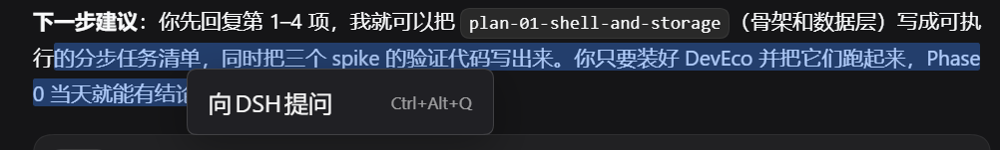

# dsh-quote-shot

涓€涓潰鍚?**Windows DSH Desktop** 鐨勪氦浜掑寮烘彃浠讹細閫変腑鑱婂ぉ銆佷唬鐮佸潡鎴栨枃浠堕瑙堜腑鐨勬枃瀛楀悗锛屽彲浠ュ甫鏉ユ簮寮曠敤鍒拌緭鍏ユ锛涗篃鍙互鎴彇灞忓箷鍖哄煙锛屾妸鎴浘淇濆瓨鍒板綋鍓嶄細璇濆伐浣滅洰褰曞苟浠ユ枃浠跺紩鐢ㄦ彃鍏ヨ緭鍏ユ銆?
鎵€鏈夊唴瀹归兘鍙繘鍏ヨ緭鍏ユ锛?*涓嶄細鑷姩鍙戦€?*銆?
## 鍔熻兘

### 鍒掕瘝寮曠敤

閫変腑鏂囧瓧鍚庯紝鑿滃崟浼氬嚭鐜板湪閫夊尯闄勮繎锛涜彍鍗曟墦寮€鏈熼棿锛屽師鏈夎摑鑹查€夊尯浼氫繚鐣欙細



- 鍦ㄨ亰澶╂秷鎭€佷唬鐮佸潡鎴栨枃浠堕瑙堜腑閫変腑鏂囧瓧锛屾寜 `Ctrl+Alt+Q`锛屾垨鍙抽敭閫夋嫨 **鍚慏SH鎻愰棶**銆?- 寮曠敤鍧椾細鑷姩甯︿笂鏉ユ簮锛?  - 鏂囦欢棰勮锛歚@鐩稿璺緞锛堢 N鈥揗 琛岋級`锛屽湪 DSH 涓樉绀轰负钃濊壊鏂囦欢寮曠敤锛?  - 鑱婂ぉ娑堟伅锛歚瀵硅瘽绗?N 杞甡锛?  - 浠ｇ爜鍧楋細棰濆鏍囨敞浠ｇ爜璇█銆?- 姣忔寮曠敤鏈熬鎻掑叆 `銆愬紩鐢ㄧ粨鏉熴€慲锛屼笌鐢ㄦ埛闅忓悗杈撳叆鐨勯棶棰樻槑纭垎寮€銆?- 鎵撳紑鍙抽敭鑿滃崟鏃讹紝閫変腑鐨勬枃瀛椾粛浠ュ崐閫忔槑钃濊壊楂樹寒淇濈暀銆?
### 鍖哄煙鎴浘

- 鎸?`Ctrl+Alt+Z`锛屾垨鐐瑰嚮杈撳叆妗嗘梺鐨勬埅鍥炬寜閽€?- 鎷栭€夊睆骞曞尯鍩熷悗锛屾诞灞傛彁渚涗袱涓搷浣滐細

| 鎿嶄綔 | 琛屼负 |
| --- | --- |
| **鍚慏SH鎻愰棶** | 鎶婃埅鍥句繚瀛樺埌褰撳墠浼氳瘽宸ヤ綔鐩綍鐨?`quote-shot-captures/`锛屼互 `@quote-shot-captures/xxx.png` 鏂囦欢寮曠敤鎻掑叆杈撳叆妗嗭紝骞堕檮 `銆愭埅鍥炬潵婧愩€慲 璇存槑銆?|
| **鍙﹀瓨涓?* | 鍙妸鎴浘鍙﹀瓨涓?PNG锛屼笉鎻掑叆杈撳叆妗嗭紱璇ユ搷浣滄病鏈夊揩鎹烽敭銆?|

- `Esc`銆佸彸閿垨鐐瑰嚮娴眰澶栭儴鍙彇娑堟埅鍥俱€?- 濡傛灉鎴浘鏉ヨ嚜 DSH 绐楀彛澶栵紝鎻掍欢浼氬皾璇曠敤鏈満 Windows OCR 璇嗗埆鎴浘涓殑璺緞锛屽苟浠モ€滆嚜鍔ㄨ瘑鍒細鈥︹€濇彁绀哄€欓€夋潵婧愩€傝瘑鍒け璐ユ椂鍙彃鍏ユ埅鍥炬枃浠跺紩鐢紝涓嶉樆濉炰富娴佺▼銆?
## 鐜瑕佹眰

- Windows 10 / 11銆?- **DSH Desktop**锛圵indows 妗岄潰鐗堬級銆傛彃浠跺湪 DSH Desktop `0.2.1-rc.2` 涓婂紑鍙戝拰楠岃瘉锛孌SH 瀹㈡埛绔帴鍙ｄ粛鍙兘闅忕増鏈彉鍖栥€?- `pnpm`锛堢敤浜庡畨瑁呭埌 DSH profile锛夈€?- Windows PowerShell 5.1锛堢郴缁熻嚜甯︼級锛汷CR 闇€瑕佺郴缁熷畨瑁呭搴旇瑷€鐨?OCR 璇█鍖呫€?- Web 鐗?DSH 鍙兘浣跨敤鍒掕瘝寮曠敤锛屼笉鑳戒娇鐢ㄥ尯鍩熸埅鍥俱€?
## 瀹夎

浠ヤ笅鍛戒护浠?PowerShell 涓轰緥銆?
### 鏂瑰紡 A锛氱洿鎺ュ畨瑁?Release 棰勬瀯寤哄寘锛堟帹鑽愶級

```powershell
$dshProfile = Join-Path $env:USERPROFILE '.dsh\profiles\desktop'
$releaseVersion = 'v0.1.1'
$releaseUrl = "https://github.com/PolarVag/dsh-quote-shot/releases/download/$releaseVersion/dsh-quote-shot.tgz"
pnpm add --dir $dshProfile $releaseUrl
```

棰勬瀯寤哄寘涓嶉渶瑕佹湰鍦版瀯寤猴紝閫傚悎鍙兂鐩存帴浣跨敤鐨勭敤鎴枫€傝鎶?`$releaseVersion` 鎹㈡垚 [Releases](https://github.com/PolarVag/dsh-quote-shot/releases) 涓殑鏈€鏂扮増鏈彿锛沺npm 鏃犳硶瑙ｆ瀽 GitHub 鐨?`releases/latest/download` 璺宠浆锛屽洜姝や笉瑕佺洿鎺ヤ娇鐢?`latest` 鍦板潃銆?
### 鏂瑰紡 B锛氫粠婧愮爜瀹夎

```powershell
$pluginPath = Join-Path $env:USERPROFILE 'dsh-quote-shot'
git clone https://github.com/PolarVag/dsh-quote-shot.git $pluginPath

$dshProfile = Join-Path $env:USERPROFILE '.dsh\profiles\desktop'
$pluginUrl = 'file:' + ($pluginPath -replace '\\', '/')
pnpm add --dir $dshProfile $pluginUrl
```

`file:` 鍚庨潰蹇呴』鏄彃浠剁洰褰曠殑缁濆璺緞锛屼娇鐢ㄦ鏂滄潬鎴栧弻鍙嶆枩鏉犮€?
### 鍚敤鎻掍欢 bundle

鎵撳紑锛?
```text
C:\Users\<鐢ㄦ埛鍚?\.dsh\profiles\desktop\package.json
```

鍦?`dsh.profile.bundles` 鏁扮粍涓姞鍏?`"dsh-quote-shot"`锛屼繚鐣欏凡鏈夋彃浠讹細

```json
{
  "dsh": {
    "profile": {
      "bundles": [
        "dsh-vision-plugin",
        "dsh-quote-shot"
      ]
    }
  }
}
```

### 瀹屽叏閲嶅惎 DSH Desktop

浠呭埛鏂伴〉闈笉澶燂紝闇€瑕?*瀹屽叏閫€鍑?DSH Desktop 鍚庨噸鏂板惎鍔?*锛岃涓昏繘绋嬪拰瀹㈡埛绔?bundle 涓€璧烽噸鏂板姞杞姐€?
## 浣跨敤

### 寮曠敤鏂囧瓧

1. 鍦ㄨ亰澶┿€佷唬鐮佸潡鎴栨枃浠堕瑙堜腑閫変腑鏂囧瓧銆?2. 鎸?`Ctrl+Alt+Q`锛屾垨鍙抽敭閫夋嫨 **鍚慏SH鎻愰棶**銆?3. 寮曠敤浼氭彃鍏ュ綋鍓嶈緭鍏ユ锛屾湯灏惧甫 `銆愬紩鐢ㄧ粨鏉熴€慲銆?4. 鍦ㄥ紩鐢ㄥ悗缁х画杈撳叆闂锛岀‘璁ゅ悗鎵嬪姩鍙戦€併€?
### 鎴浘

1. 鎸?`Ctrl+Alt+Z`锛屾垨鐐瑰嚮杈撳叆妗嗘梺鐨勬埅鍥炬寜閽€?2. 鎷栭€夊尯鍩熴€?3. 閫夋嫨 **鍚慏SH鎻愰棶** 鎴?**鍙﹀瓨涓?*銆?
鎴浘鏂囦欢榛樿淇濆瓨鍒板綋鍓嶄細璇濆伐浣滅洰褰曪細

```text
<session workspace>/quote-shot-captures/shot-YYYYMMDD-HHmmss.png
```

濡傛灉宸ヤ綔鐩綍涓嶅彲鍐欙紝鎴栬€呭綋鍓嶄細璇濇病鏈夎В鏋愬嚭 `cwd`锛屼細閫€鍥炰复鏃跺浘鐗囬檮浠舵柟寮忋€?
### 淇敼蹇嵎閿?
蹇嵎閿€氳繃 DSH 鐨勫揩鎹烽敭璁剧疆娉ㄥ唽锛岄粯璁ゅ€间负锛?
- 鍒掕瘝寮曠敤锛歚Ctrl+Alt+Q`
- 鍖哄煙鎴浘锛歚Ctrl+Alt+Z`

濡傛灉涓庡叾瀹冨懡浠ゅ啿绐侊紝DSH 浼氭嫆缁濇敞鍐屾垨鎻愮ず鍐茬獊锛涜鍦?DSH 鐨勫揩鎹烽敭璁剧疆涓敼缁戙€?*鍙﹀瓨涓?*鏈夋剰涓嶆彁渚涘揩鎹烽敭銆?
## 闅愮涓庝复鏃舵枃浠?
- 鎴浘涓存椂鏂囦欢浣嶄簬 `%TEMP%\dsh-quote-shot`锛屼复鏃?PNG 鐨?TTL 涓?**1 灏忔椂**銆?- 閫夋嫨 **鍚慏SH鎻愰棶** 鍚庯紝PNG 浼氬鍒跺埌浼氳瘽宸ヤ綔鐩綍鐨?`quote-shot-captures/`锛涜繖鏄璇?鎶ュ憡鍐呭鐨勪竴閮ㄥ垎锛屽嵏杞芥彃浠朵笉浼氳嚜鍔ㄥ垹闄ゃ€?- 鍙栨秷鎴浘鎴栧彟瀛樹负鍚庯紝涓存椂 PNG 浼氳鍒犻櫎銆?- 鎻掍欢涓嶈鍐欏壀璐存澘锛屼笉涓婁紶鍥剧墖鎴栨枃瀛楋紝涔熶笉璋冪敤澶栭儴瑙嗚鏈嶅姟銆?- OCR 鍦ㄦ湰鏈洪€氳繃 Windows WinRT OCR锛圥owerShell锛夊畬鎴愶紱浠呭湪鎴浘鍖哄煙涓?DSH 绐楀彛涓嶇浉浜や笖娌℃湁 DOM 鏉ユ簮鏃跺皾璇曪紝棰勭畻 **4 绉?*锛屽け璐ユ垨瓒呮椂闈欓粯璺宠繃銆?
## 鍏煎鎬т笌宸茬煡闄愬埗

- 鎴浘渚濊禆 DSH Desktop 鐨勬湰鍦?Web 鏈嶅姟涓?PowerShell锛學eb 鐗堜笉鍙敤銆?- 鍘熺敓鍙抽敭鑿滃崟鏃犳硶鐢辨彃浠剁洿鎺ユ墿灞曪紱鎻掍欢浣跨敤 DOM 鑿滃崟锛屽苟鍦ㄨ瘑鍒埌鍖归厤閫夊尯鏃跺敖閲忔姂鍒跺師鐢熻彍鍗曘€備笉鍚?DSH/Electron 鐗堟湰涓嬬郴缁熻彍鍗曚粛鍙兘鍑虹幇銆?- 鏂囦欢寮曠敤鍜岄€夊尯楂樹寒渚濊禆 DSH 瀹㈡埛绔殑 DOM 缁撴瀯锛汥SH 鍗囩骇鍚庡彲鑳介渶瑕侀€傞厤銆?- 楂?DPI銆佸鏄剧ず鍣ㄥ拰娣峰悎缂╂斁鍦烘櫙鎸夌墿鐞嗗儚绱犳崲绠楋紱棣栨浣跨敤鍓嶅缓璁湪鏈満瀹為檯楠屾敹銆?- v1 灏氭湭瀹炵幇 OCR 寮€鍏宠缃紝OCR 甯稿紑銆?- 鎴浘鏂囦欢澶圭敱鐢ㄦ埛鑷娓呯悊锛涙彃浠朵笉浼氳嚜鍔ㄥ垹闄ゅ伐浣滅洰褰曚腑鐨勫巻鍙叉埅鍥俱€?- HTTP 璺敱娉ㄥ唽涓?`auth: required`锛屽苟鍦?DSH 0.2.1/0.2.2 瀹夸富涓婇€氳繃 `connection.requestRejection` 鎵ц Host/Origin 涓庤璇佹鏌ワ紱鏈€氳繃鏃惰繑鍥?401/403銆侱SH 0.2.3 鍙婁互涓婄殑 Web 鏈嶅姟浼氬啀鎵ц鑷韩鐨勯壌鏉冪瓥鐣ャ€?
## 鏁呴殰鎺掓煡

**鎴浘鎸夐挳鎻愮ず鈥滄埅鍥句粎妗岄潰绔彲鐢ㄢ€?*

- 纭鏄?Windows DSH Desktop锛岃€屼笉鏄祻瑙堝櫒 Web 鐗堛€?- 纭宸插畬鍏ㄩ噸鍚?DSH锛屼笖 `dsh.profile.bundles` 涓惈 `dsh-quote-shot`銆?- 妫€鏌?profile 鐨?`node_modules\dsh-quote-shot` 鏄惁瀛樺湪銆?
**鎻愮ず鈥滄埅鍥鹃檮鍔犲け璐ワ紙璇诲彇鍥剧墖锛夆€?*

- 閫氬父鏄彃浠剁増鏈繃鏃ф垨鍥剧墖璺敱鏈姞杞姐€傛洿鏂板埌鏈€鏂扮増鏈苟瀹屽叏閲嶅惎 DSH銆?
**鎻愮ず鈥滄埅鍥鹃檮鍔犲け璐ワ紙鎻掑叆鏂囦欢寮曠敤锛夆€?*

- 妫€鏌ュ綋鍓嶄細璇濆伐浣滅洰褰曟槸鍚﹀彲鍐欍€?- 妫€鏌ユ槸鍚﹀湪鎴浘鏈熼棿鍒囨崲浜嗕細璇濓紱鎻掍欢浼氭妸鎴浘鍥哄畾鍦ㄥ紑濮嬫埅鍥炬椂鐨勪細璇濓紝涓嶄細鍐欏叆鍙︿竴涓細璇濄€?
**鍙抽敭鍚庝粛鍑虹幇绯荤粺鑿滃崟**

- 杩欐槸 Electron 鍘熺敓鑿滃崟鐨?best-effort 鎶戝埗锛屾棤娉曚繚璇佸湪鎵€鏈夌増鏈兘娑堝け锛涙彃浠惰嚜宸辩殑鈥滃悜DSH鎻愰棶鈥濊彍鍗曚粛鍙娇鐢ㄣ€?
**蹇嵎閿病鏈夊弽搴?*

- 鍦?DSH 蹇嵎閿缃腑妫€鏌ユ槸鍚﹀啿绐佹垨琚鐢ㄣ€?- 纭 DSH 绐楀彛澶勪簬鍓嶅彴锛涘揩鎹烽敭涓嶆槸绯荤粺绾у叏灞€鐑敭銆?
## 寮€鍙?
```powershell
cd $pluginPath
node --test test/*.test.js
```

褰撳墠娴嬭瘯锛?*106 涓祴璇曞叏閮ㄩ€氳繃锛?06 pass / 0 fail锛?*銆?
鐩綍缁撴瀯锛?
```text
lib/
  index.js        Host 鍗婏細Web 璺敱銆佹埅鍥惧瓨鍌ㄣ€佸伐浣滅洰褰曞鍒躲€丱CR
  client.js       Client 鍗婏細鍙抽敭寮曠敤銆侀€夊尯楂樹寒銆佸揩鎹烽敭銆佹埅鍥?UI
  capture.js      鎴浘缁撴灉瑙ｆ瀽銆佷复鏃舵枃浠朵笌 token 绠＄悊
scripts/
  capture.ps1     WinForms 鍖哄煙鎴浘娴眰
  ocr.ps1         Windows WinRT OCR
test/             鍗曞厓娴嬭瘯
cordis.patch.yml  DSH 鎻掍欢娉ㄥ唽
```

鎵撳寘妫€鏌ワ細

```powershell
npm pack --dry-run --json
```

`npm pack` 鍙寘鍚繍琛屾墍闇€鏂囦欢锛屼笉鍖呭惈 `test/` 涓?`.superpowers/`銆?
## License

MIT
